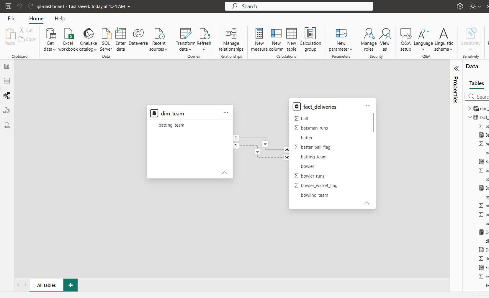
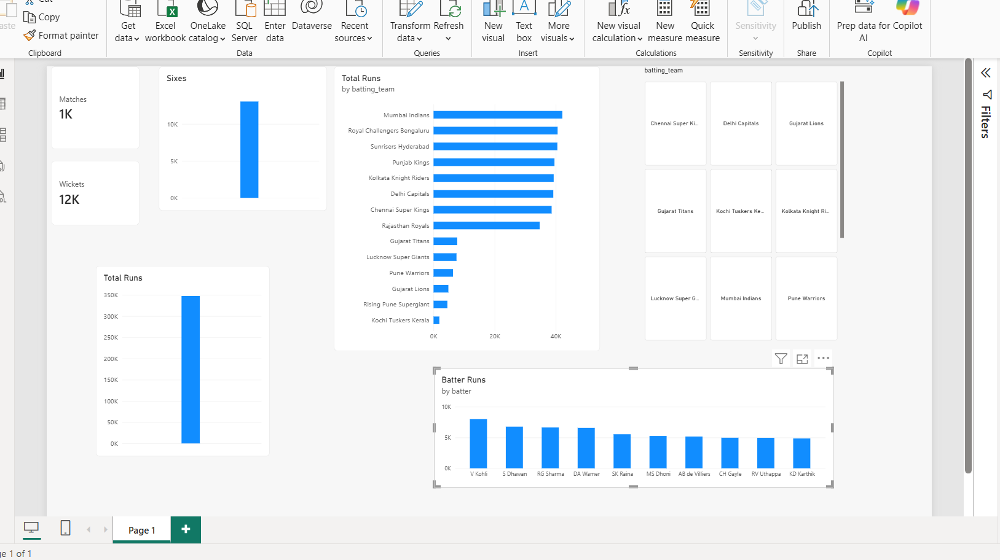

# IPL Analytics Power BI Dashboard (2008–2024)

An end-to-end data analytics and business intelligence project exploring 17 seasons of Indian Premier League (IPL) cricket history. The pipeline processes over 260,000 ball-by-ball delivery records using Python and pandas into optimized dimensional star-schema tables for analysis and reporting in Power BI Desktop.

---

## Business Questions

This project explores key analytical questions in modern T20 cricket:
1. **Strike Rate vs. Economy:** How do top batters balance scoring speed with volume, and which bowlers keep run rates low while taking wickets?
2. **Team and player performance:** Which franchises and players have scored the most runs across 2008-2024?

---
https://www.kaggle.com/datasets/patrickb1912/ipl-complete-dataset-20082020
## Data Source

- **Dataset**: Kaggle IPL Complete Dataset (2008–2024) ball-by-ball delivery data.
- **Raw Files**: Raw data (`deliveries.csv` and optional `matches.csv`) is not tracked in version control due to file size constraints.
- Download: [IPL Complete Dataset (2008-2024)](https://www.kaggle.com/datasets/patrickb1912/ipl-complete-dataset-20082020)

---

## How to Reproduce

1. **Clone the repository**:
   ```bash
   git clone https://github.com/<your-username>/ipl-dashboard.git
   cd ipl-dashboard
   ```

2. **Set up Python Virtual Environment**:
   ```bash
   python -m venv .venv
   # Windows:
   .\.venv\Scripts\activate
   # macOS / Linux:
   source .venv/bin/activate
   ```

3. **Install Dependencies**:
   ```bash
   pip install -r requirements.txt
   ```

4. **Add Raw Data**:
   Ensure `data/raw/deliveries.csv` is present.

5. **Run the Data Preparation Pipeline**:
   ```bash
   python scripts/prepare_data.py
   ```
   This generates:
   - `data/clean/fact_deliveries.csv`: Cleaned ball-by-ball facts with engineered flags and phases.
   - `data/clean/dim_team.csv`: Standardized franchise dimension.
   - `data/clean/dim_matches.csv` (if `matches.csv` is present).

6. **Open Dashboard**:
   Load the cleaned CSVs into Power BI Desktop and follow the measures defined in [`docs/dax_measures.md`](docs/dax_measures.md).

---

## Data Model


## Dashboard Screenshots

### Overview


### Strike Rate vs Economy


## Key Insights
1. V Kohli has scored about 8,004 IPL runs at a strike rate of about 132.
2. JJ Bumrah has taken about 165 wickets at an economy of about 7.3.
3. (Add one finding you can see in your own scatter plots)

---

## Tools Used

- **Python 3.12**: Environment scripting and orchestration
- **pandas**: Vectorized data transformation, feature engineering, and cleaning
- **Power BI Desktop**: Data modeling, interactive visualization, and dashboard design
- **DAX (Data Analysis Expressions)**: Custom dynamic business measures and time/phase aggregations
- **Git & GitHub**: Version control and project documentation
